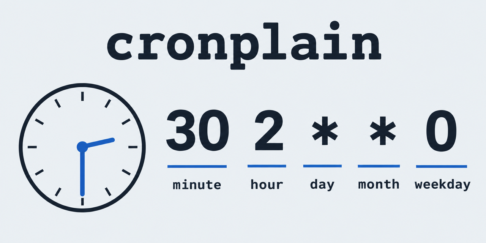
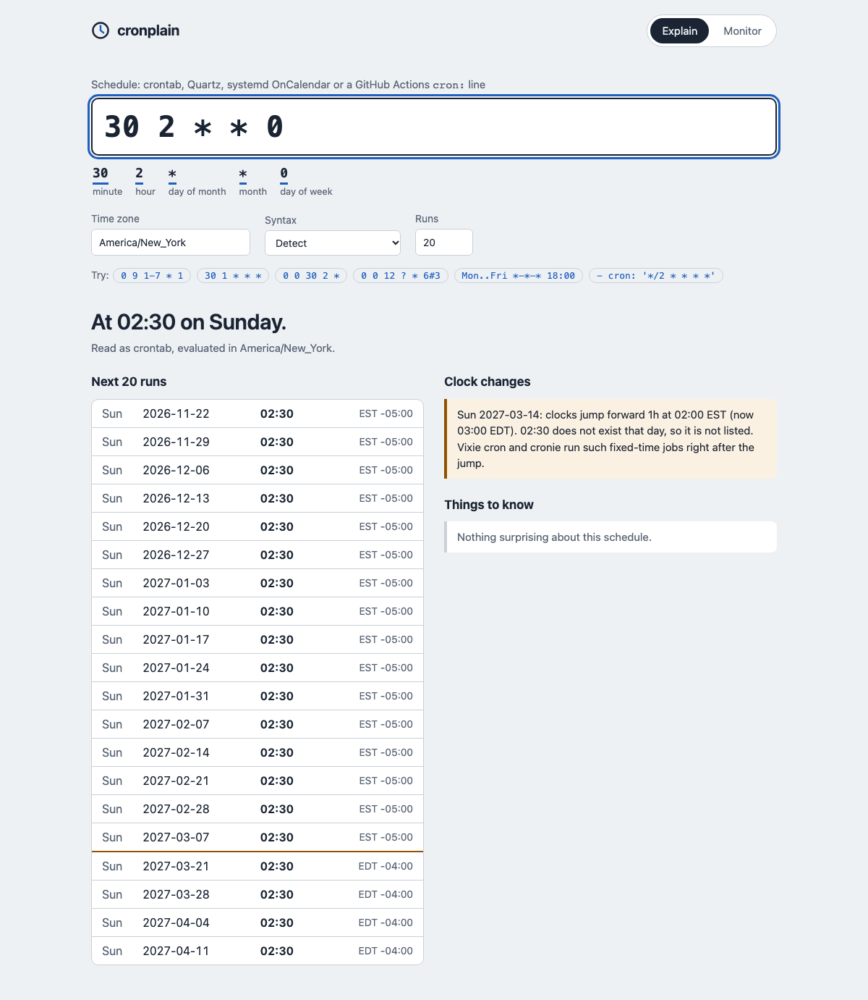
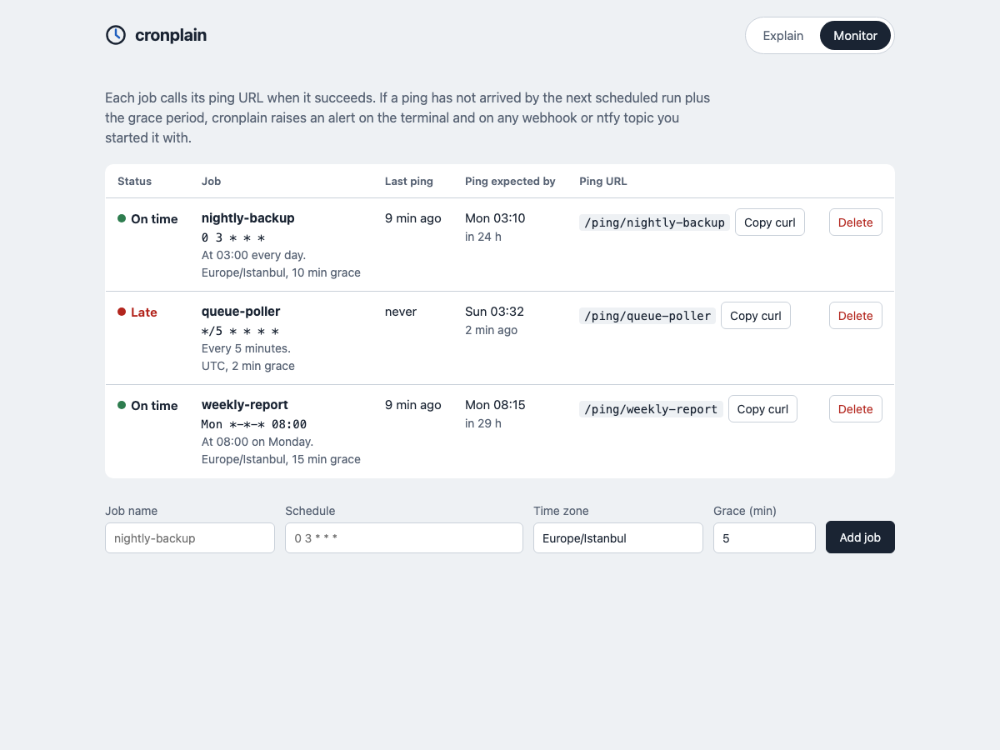

# cronplain



Understand, test and monitor scheduled jobs from one small Go binary.
It explains cron, Quartz, systemd and GitHub Actions schedules in plain English, lists their next runs with daylight-saving changes called out, audits whole crontabs, and runs a local heartbeat monitor that tells you when a job did not report in.



## Quickstart

You need Go 1.26 or newer (no C compiler: the SQLite driver is pure Go).

```sh
go install github.com/Habibeyilmazz/cronplain@latest

cronplain explain "0 9 1-7 * 1"
cronplain audit /etc/crontab -system
cronplain serve            # dashboard on http://127.0.0.1:4230
```

Or from a clone:

```sh
git clone https://github.com/Habibeyilmazz/cronplain
cd cronplain
go build -o cronplain .
./cronplain audit examples/crontab.sample
```

Prebuilt binaries will appear on the Releases page once a version tag is pushed (`.goreleaser.yaml` is ready; no release has been made yet).

## Features

### Explain a schedule

```text
$ cronplain explain --tz America/New_York -n 20 "30 2 * * 0"
30 2 * * 0   [cron, evaluated in America/New_York]
At 02:30 on Sunday.

Next 20 runs (America/New_York):
   1  Sun 2026-11-22 02:30 EST (-05:00)
   ...
  16  Sun 2027-03-07 02:30 EST (-05:00)
  17  Sun 2027-03-21 02:30 EDT (-04:00)
   ...

Daylight saving time:
  - Sun 2027-03-14: clocks jump forward 1h at 02:00 EST (now 03:00 EDT). 02:30 does not exist
    that day, so it is not listed. Vixie cron and cronie run such fixed-time jobs right after the jump.
```

- **Syntaxes**, detected automatically or forced with `-dialect`:

  | Syntax | Example | Notes |
  |---|---|---|
  | crontab (Vixie cron, cronie) | `*/15 9-17 * * MON-FRI` | 5 fields, names, ranges, steps, `7` = Sunday |
  | macros | `@daily`, `@hourly`, `@reboot` | `@reboot` is explained but has no times |
  | `CRON_TZ=` / `TZ=` prefix | `CRON_TZ=Europe/Istanbul 0 9 * * *` | evaluates in that zone |
  | seconds first (Spring, robfig/cron) | `0 */5 * * * *` | 6 fields without `?` |
  | Quartz | `0 0 12 ? * 6#3`, `0 0 12 L * ?`, `0 0 12 15W * ?` | `?`, `L`, `LW`, `nW`, `nL`, `n#k`, optional year; days 1-7 = Sunday-Saturday |
  | systemd `OnCalendar=` | `Mon..Fri *-*-* 09:00 Europe/Istanbul` | weekdays, `[YYYY-]MM-DD`, `HH:MM[:SS]`, lists, `..` ranges, `/` steps, zone suffix, `daily`/`weekly`/... |
  | GitHub Actions | `- cron: '30 5 * * 1'` | pasted YAML line works; always evaluated in UTC |

  Supported **not** yet: systemd `~` (days from the end of the month) and fractional seconds, Quartz `L-3` offsets, wrap-around ranges such as `FRI-MON` in crontab syntax. Each one is rejected with a message rather than guessed.
  Quartz extensions in a 5-field crontab are rejected with an explanation, because Vixie cron, cronie and GitHub Actions do not accept them.

- **Next runs in any IANA zone** (`-tz`, default: the machine's zone), up to 500, as text or `-json`.
- **DST is computed, not assumed.** Runs are wall-clock matches: a time inside a spring-forward gap does not fire and a time inside a fall-back overlap fires twice and is marked. Each clock change in the window says which scheduled times it skips or repeats, and for crontab syntax how Vixie cron and cronie handle it differently.
- **Lint notes**, for example:
  - day-of-month and day-of-week both set means *either* matches in Vixie cron (`0 9 1-7 * 1` is not "the first Monday");
  - runs every minute (or every few seconds);
  - never fires (`0 0 30 2 *`), skips short months (`0 0 31 * *`), February 29 only in leap years;
  - `*/7` in minutes is uneven across the hour;
  - GitHub Actions: UTC, at most every 5 minutes, busy minute 0, default branch only and 60-day inactivity pause;
  - systemd: weekday *and* date must match; no zone means the machine's zone.

### Audit a crontab

```text
$ cronplain audit examples/crontab.sample
10 job(s): 0 error(s), 7 warning(s), 3 note(s)
  file     warn  PATH is not set: cron uses a minimal PATH (often /usr/bin:/bin), so "pg_dump" on line 7 may not be found. ...
  line 5   warn  lines 5, 6, 7, 21 start at the same minute (first at Mon 00:00 +03), 7 time(s) in the next 7 days; stagger them ...
  line 7   warn  unescaped % in the command: cron turns it into a newline and feeds the rest to stdin ...
  line 11  info  runs every 2 minute(s) with no lock: if one run takes longer, the next starts on top of it. Wrap it with flock -n ...
  ...
```

Checks: schedule errors and the lint warnings above, `PATH` and `SHELL` not set (escalated when a command uses bash syntax), output not redirected (or discarded by `MAILTO=""`), only stdout redirected, unescaped `%`, the same command on two lines, frequent jobs without `flock`, and start-time collisions over the next 7 days (three or more jobs in the same minute is a warning).
Use `-system` for `/etc/crontab` and `/etc/cron.d/*` (user field after the schedule), `-` to read stdin, `-json` for machines. The exit code is 1 when there is any warning or error, so it can gate CI.

### Heartbeat monitor



```sh
cronplain serve -db ~/.cronplain.db -ntfy my-server-jobs
```

1. Open `http://127.0.0.1:4230`, switch to **Monitor** and add a job: a name, its schedule (any syntax above), its time zone and a grace period.
2. Make the job report success, for example in a crontab:
   `0 3 * * * /opt/bin/backup && curl -fsS http://127.0.0.1:4230/ping/nightly-backup`
3. If no ping arrives by *the first scheduled run after the last ping + grace*, cronplain alerts once, and again with "recovered" when the next ping arrives.

Alerts always go to the terminal, and optionally to `-webhook URL` (JSON `POST` with `job`, `state`, `schedule`, `due`, `last_ping`, `message`) and to an ntfy topic (`-ntfy TOPIC`, `-ntfy-server` defaults to `https://ntfy.sh`).
Jobs and ping times live in one SQLite file (`-db`). Pings accept `GET`, `POST` or `HEAD`.

The dashboard has no login, so `serve` only binds to loopback addresses and refuses anything else. It also rejects requests with a foreign `Host` header (DNS rebinding) and cross-site `POST`/`DELETE` from browsers.

## How it works

- `internal/sched` parses every syntax into one model: bitsets for second, minute, hour, day, month and weekday, an optional year set, the Quartz extensions, and whether the Vixie "either day field" rule applies. The English sentence is built from the parsed fields, not from regexes over the text.
- Run times are found by walking calendar days in the target zone, listing the matching wall-clock times and converting each one to real instants. A wall time can map to zero instants (DST gap), one, or two (DST overlap); that is where the DST notes come from. Clock changes are found with Go's `time.Time.ZoneBounds`. The time zone database is embedded (`time/tzdata`), so results do not depend on the host.
- Searches stop after 100 years, which is how "never fires" is decided.
- `internal/audit` reuses the engine per line and simulates the next 7 days to find collisions.
- `internal/monitor` is `net/http` (with `http.CrossOriginProtection`), `modernc.org/sqlite` and one embedded HTML page with no build step and no external requests.

Tests are table-driven and cover DST in America/New_York, Europe/Berlin and Europe/Istanbul (including its last DST changes in 2015-2016 and none since), leap years and 2100, 30 February never firing, Quartz edge cases such as `1W` on a Saturday, the Vixie OR rule, the audit checks, and the monitor end to end against fake webhook and ntfy servers.

```sh
go test -race ./...
```

## Roadmap

- systemd `~` last-day syntax and Quartz `L-n` offsets.
- Optional token so pings can come from other machines through a reverse proxy.
- A `/ping/<id>/fail` endpoint and a short ping history per job.
- A static, offline build of the explainer page (today it is served by `cronplain serve`).

## License

MIT, see [LICENSE](LICENSE).
